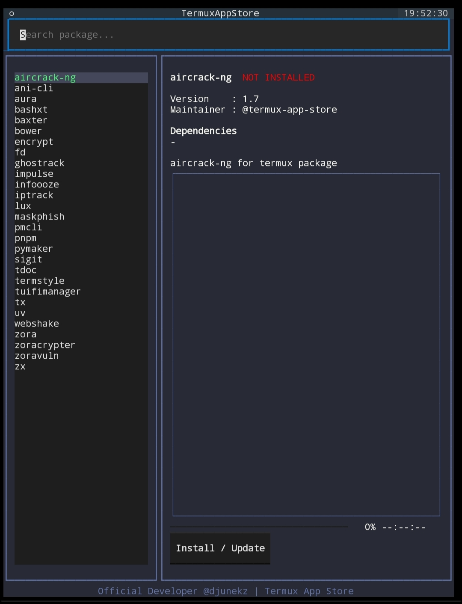

](https://github.com/djunekz/termux-app-store/raw/master/.assets/00.jpeg)

# [Termux App Store — Termux के लिए TUI & CLI Package Manager](https://djunekz.github.io/termux-app-store/)

**Android पर Termux के लिए बनाया गया लोकल-फ़र्स्ट TUI और CLI पैकेज मैनेजर, चेकसम-वेरिफ़ाइड बाइनरी इंस्टॉल और सोर्स-बिल्ड फ़ॉलबैक के साथ।**

<div align="center">

<a href="https://github.com/djunekz/termux-app-store/actions/workflows/build.yml"></a>
<a href="https://github.com/djunekz/termux-app-store/actions/workflows/cli-ci.yml"></a>
<a href="https://github.com/djunekz/termux-app-store/actions/workflows/codeql.yml"></a>
<a href="https://github.com/djunekz/termux-app-store/actions/workflows/lint-checker.yml"></a>
<a href="https://github.com/djunekz/termux-app-store/actions/workflows/build-packages-debs.yml"></a>
<a href="https://github.com/djunekz/termux-app-store/actions/workflows/update_index.yml"></a>
<a href="https://github.com/djunekz/termux-app-store/actions/workflows/publish.yml"></a>
<br>
<a href="https://pypi.org/project/termux-app-store/"></a>
<a href="https://pypi.org/project/termux-app-store/"></a>
<a href="https://pypi.org/project/termux-app-store/"></a>
<a href="https://github.com/djunekz/termux-app-store/releases"></a>
<a href="https://github.com/djunekz/termux-app-store/releases"></a>
<a href="https://github.com/djunekz/termux-app-store/releases"></a>
<br>
<a href="https://codecov.io/github/djunekz/termux-app-store"></a>
<a href="https://www.repo-grade.com/report/djunekz/termux-app-store"></a>
<a href="https://github.com/astral-sh/ruff"></a>
<a href="https://mypy-lang.org/"></a>
<a href="https://docs.pytest.org/"></a>
<a href="https://github.com/djunekz/termux-app-store/blob/master/SECURITY.md"></a>
<br>
<a href="https://github.com/djunekz/termux-app-store/tree/master/packages"></a>
<a href="https://termux.dev/"></a>
<a href="https://github.com/djunekz/termux-app-store/blob/master/ARCHITECTURE.md"></a>
<a href="https://github.com/Textualize/textual"></a>
<a href="https://github.com/djunekz/termux-app-store#readme"></a>
<a href="https://github.com/djunekz/termux-app-store/blob/master/SECURITY.md"></a>
<a href="https://github.com/djunekz/termux-app-store/blob/master/PRIVACY.md"></a>
<br>
<a href="https://github.com/djunekz/termux-app-store/blob/master/LICENSE"></a>
<a href="https://github.com/djunekz/termux-app-store/stargazers"></a>
<a href="https://github.com/djunekz/termux-app-store/network/members"></a>
<a href="https://github.com/djunekz/termux-app-store/watchers"></a>
<a href="https://github.com/djunekz/termux-app-store/graphs/contributors"></a>
<a href="https://github.com/djunekz/termux-app-store/issues"></a>
<a href="https://github.com/djunekz/termux-app-store/issues?q=is%3Aissue+is%3Aclosed"></a>
<a href="https://github.com/djunekz/termux-app-store/pulls"></a>
<a href="https://github.com/djunekz/termux-app-store/blob/master/CONTRIBUTING.md"></a>
<br>
<a href="https://github.com/djunekz/termux-app-store/commits/master"></a>
<a href="https://github.com/djunekz/termux-app-store/graphs/commit-activity"></a>
<a href="https://github.com/djunekz/termux-app-store"></a>
<a href="https://github.com/djunekz/termux-app-store"></a>
<a href="https://github.com/djunekz/termux-app-store"></a>
<a href="https://github.com/djunekz/termux-app-store"></a>
<a href="https://github.com/djunekz/termux-app-store/blob/master/CODE_OF_CONDUCT.md"></a>

</div>


> **लोकल-फ़र्स्ट • चेकसम-वेरिफ़ाइड • सोर्स-आधारित • Termux-नेटिव • Android Terminal**
> Termux पैकेज इंस्टॉल करें और प्रबंधित करें — बिना root, बिना account, बिना tracking के।

> अन्य भाषाओं में पढ़ें: 🇬🇧 **[English](README.md)** | 🇮🇩 **[Bahasa Indonesia](README.id.md)** | 🇹🇭 **[ภาษาไทย](README.th.md)** | 🇯🇵 **[日本語](README.jp.md)** | 🇨🇳 **[中文](README.ch.md)** | 🇻🇳 **[Tiếng Việt](README.vi.md)**

---

## Termux App Store क्या है?

**Termux App Store** Python ([Textual](https://github.com/Textualize/textual)) से बना एक **TUI & CLI पैकेज मैनेजर** है जो Android पर Termux उपयोगकर्ताओं को सीधे डिवाइस पर **टूल्स/पैकेज ब्राउज़ करने, इंस्टॉल करने और प्रबंधित करने** की सुविधा देता है — बिना account, बिना telemetry, बिना root। पैकेज मेटाडेटा और डाउनलोड के लिए नेटवर्क का उपयोग होता है।

**v0.4.0** से **फ़ास्ट इंस्टॉल इंजन** जोड़ा गया है: मिरर पूल (GitHub Pages, Cloudflare CDN, jsDelivr) से पहले से बने `.deb` बाइनरी फ़ाइलें डाउनलोड होती हैं, लोकल `.deb` कैश (TTL 7 दिन) के साथ। कैश सहित हर `.deb` का आर्किटेक्चर-वाइज SHA256 से मेल खाना ज़रूरी है, वरना उसे अस्वीकार कर दिया जाता है। SHA256 फ़ाइल के खराब या बेमेल होने का पता लगाता है; यह प्रकाशक का हस्ताक्षर नहीं है। पूर्ण नियंत्रण के लिए `fix-install` से सोर्स बिल्ड भी उपलब्ध है।

> [!IMPORTANT]
> Termux App Store **कोई छिपा हुआ ऑटो-इंस्टॉलर नहीं है**।
> सभी इंस्टॉलेशन — बाइनरी या सोर्स — **लोकल, पारदर्शी और पूरी तरह उपयोगकर्ता के नियंत्रण में** चलते हैं।

---

## स्क्रीनशॉट

| TUI मुख्य | TUI इंस्टॉल | Command Palette |
|---|---|---|
| [](https://github.com/djunekz/termux-app-store/blob/master/.assets/0main.jpg) | [](https://github.com/djunekz/termux-app-store/blob/master/.assets/1install.jpg) | [](https://github.com/djunekz/termux-app-store/blob/master/.assets/2pallete.jpg) |

---

## इंस्टॉल और अनइंस्टॉल

### विकल्प 1 (अनुशंसित)

```bash
pkg install python
pip install termux-app-store
```

### विकल्प 2 (मैन्युअल)

```bash
curl -fsSL https://raw.githubusercontent.com/djunekz/termux-app-store/master/tasctl | bash -s install
```

इंस्टॉल के बाद चलाएं:

```bash
termux-app-store    # इंटरेक्टिव TUI खोलें
tas                 # शॉर्टहैंड कमांड
termux-app-store -h # CLI सहायता दिखाएं
```

### अनइंस्टॉल

```bash
pip uninstall termux-app-store
```

---

## उपयोग

### TUI — इंटरेक्टिव इंटरफ़ेस

```bash
termux-app-store
# या शॉर्टहैंड:
tas
```

### CLI — सीधे कमांड

```bash
termux-app-store list                     # सभी पैकेज सूचीबद्ध करें
termux-app-store show <पैकेज>             # पैकेज विवरण दिखाएं
termux-app-store install <पैकेज>          # फ़ास्ट इंस्टॉल (पहले से बना .deb)
termux-app-store install pkg1 pkg2 pkg3   # कई पैकेज एक साथ इंस्टॉल करें
termux-app-store fix-install <पैकेज>      # सोर्स बिल्ड को मजबूर करें
termux-app-store search <कीवर्ड>          # पैकेज खोजें
termux-app-store update                   # उपलब्ध अपडेट जांचें
termux-app-store upgrade                  # सभी पैकेज अपग्रेड करें
termux-app-store mirrors                  # मिरर स्थिति जांचें
termux-app-store cache info               # कैश जानकारी देखें
termux-app-store cache clear              # कैश साफ़ करें
termux-app-store version                  # नवीनतम संस्करण जांचें
termux-app-store help                     # पूरी सहायता
```

---

## फ़ास्ट इंस्टॉल कैसे काम करता है (v0.4.0+)

v0.4.0 से, इंस्टॉलेशन डिफ़ॉल्ट रूप से पहले से बने `.deb` बाइनरी डाउनलोड करती है:

1. लोकल `.deb` कैश जांचें (TTL 7 दिन)
2. कैश मिस होने पर मिरर क्रम से आज़माएं: GitHub Pages → Cloudflare CDN → jsDelivr CDN → raw GitHub
3. आर्किटेक्चर-वाइज SHA256 वेरिफ़िकेशन (`sha256_by_arch`)
4. लोकल में कैश करें और `dpkg -i` से इंस्टॉल करें

> फ़ास्ट इंस्टॉल विफल होने पर, `build-package.sh` के ज़रिए पूरा सोर्स बिल्ड करने के लिए `fix-install <पैकेज>` इस्तेमाल करें।

---

## पैकेज स्टेटस बैज

| बैज | विवरण |
|---|---|
| **NEW** | नया जोड़ा गया पैकेज (7 दिनों के अंदर) |
| **UPDATE** | नया संस्करण उपलब्ध है |
| **INSTALLED** | इंस्टॉल है और अप-टू-डेट है |
| **UNSUPPORTED** | Termux में dependency उपलब्ध नहीं |

---

## पैकेज जोड़ना

हर पैकेज एक `build.sh` फ़ाइल से परिभाषित होता है:

```
packages/<टूल-का-नाम>/build.sh
```

### न्यूनतम `build.sh` टेम्पलेट

```bash
TERMUX_PKG_HOMEPAGE=""
TERMUX_PKG_DESCRIPTION=""
TERMUX_PKG_LICENSE=""
TERMUX_PKG_MAINTAINER="@आपका-github-username"
TERMUX_PKG_VERSION=""
TERMUX_PKG_SRCURL=""
TERMUX_PKG_SHA256=""
```

```bash
cd termux-app-store
./termux-build create आपके-टूल-का-नाम
# या GitHub URL से ऑटो-क्रिएट करें:
./termux-build init https://github.com/user/repo
```

---

## सहायक टूल्स

### termux-build

```bash
./termux-build create <पैकेज>      # वितरण के लिए पैकेज बनाएं
./termux-build init <url>           # GitHub URL से ऑटो-क्रिएट करें
./termux-build lint <पैकेज>        # बिल्ड स्क्रिप्ट की जांच करें
./termux-build doctor               # पर्यावरण डायग्नोज़ करें
./termux-build template             # build.sh टेम्पलेट जनरेट करें
```

### tasctl

```bash
./tasctl install       # Termux App Store इंस्टॉल करें
./tasctl update        # नवीनतम संस्करण में अपडेट करें
./tasctl uninstall     # Termux App Store हटाएं
./tasctl doctor        # पर्यावरण डायग्नोज़ करें
./tasctl self-update   # tasctl खुद को अपडेट करे
```

---

## सुरक्षा और गोपनीयता

- अतिरिक्त अनुमति की ज़रूरत नहीं, कोई बैकग्राउंड सर्विस नहीं
- कोई account नहीं, कोई registration नहीं
- कोई analytics, tracking या telemetry नहीं
- हर `.deb` (डाउनलोड और कैश) के लिए SHA256 अनिवार्य
- लोकल-फ़र्स्ट डिज़ाइन (मेटाडेटा और डाउनलोड के लिए नेटवर्क का उपयोग)

> विवरण: [SECURITY.md](SECURITY.md) | [PRIVACY.md](PRIVACY.md) | [BINARY_DISCLAIMER.md](BINARY_DISCLAIMER.md)

---

## लाइसेंस

**MIT लाइसेंस** — विवरण के लिए [LICENSE](LICENSE) देखें।

---

## अनुरक्षक

**Djunekz** — स्वतंत्र डेवलपर

[](https://github.com/djunekz)

---

**© Termux App Store — सभी के लिए बनाया गया, समुदाय द्वारा।**
