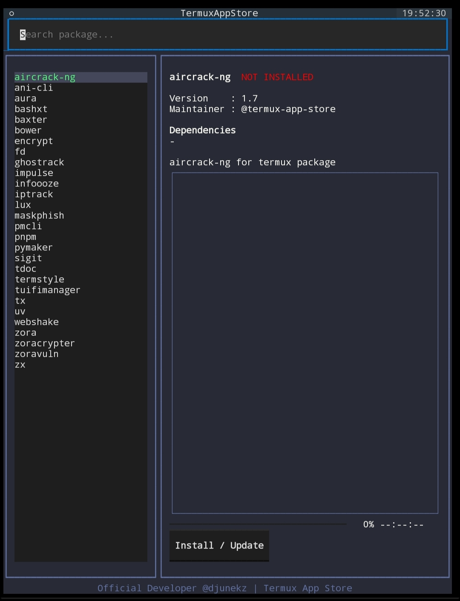

](https://github.com/djunekz/termux-app-store/raw/master/.assets/00.jpeg)

# [Termux App Store — TUI & CLI パッケージマネージャー](https://djunekz.github.io/termux-app-store/)

**Android の Termux 向けに作られた、ローカルファーストの TUI & CLI パッケージマネージャー。チェックサム検証付きバイナリインストールとソースビルドのフォールバックに対応。**

[](https://github.com/djunekz/termux-app-store/actions)
[](https://pypi.org/project/termux-app-store/)
[](LICENSE)
[](https://github.com/djunekz/termux-app-store/stargazers)

> **ローカルファースト • チェックサム検証 • ソースベース • Termux ネイティブ • Android ターミナル**
> ルート不要、アカウント不要、テレメトリなしで Termux パッケージを管理。

> 他の言語で読む: 🇬🇧 **[English](README.md)** | 🇮🇩 **[Bahasa Indonesia](README.id.md)** | 🇹🇭 **[ภาษาไทย](README.th.md)** | 🇨🇳 **[中文](README.ch.md)** | 🇻🇳 **[Tiếng Việt](README.vi.md)** | 🇮🇳 **[हिन्दी](README.in.md)**

---

## Termux App Store とは？

**Termux App Store** は Python ([Textual](https://github.com/Textualize/textual)) で作られた **TUI & CLI パッケージマネージャー**です。Android の Termux ユーザーがツールやパッケージをデバイス上で直接**ブラウズ、インストール、管理**できます — アカウント不要、テレメトリなし、ルート不要。パッケージ情報とダウンロードにはネットワークを使用します。

**v0.4.0** からは **ファストインストールエンジン**を搭載: ミラープール（GitHub Pages、Cloudflare CDN、jsDelivr）からビルド済み `.deb` バイナリをダウンロードし、ローカルキャッシュ（TTL 7日）に対応します。キャッシュを含むすべての `.deb` はアーキテクチャ別 SHA256 と一致しなければ拒否されます。SHA256 は破損や不一致の検出用であり、発行元の署名ではありません。完全制御が必要な場合は `fix-install` でソースビルドも利用可能。

> [!IMPORTANT]
> Termux App Store は **隠れた自動インストーラーではありません**。
> すべてのインストールはユーザーの明示的なコマンドにより**ローカルかつ透明に**実行されます。

---

## スクリーンショット

| TUI メイン | TUI インストール | コマンドパレット |
|---|---|---|
| [](https://github.com/djunekz/termux-app-store/blob/master/.assets/0main.jpg) | [](https://github.com/djunekz/termux-app-store/blob/master/.assets/1install.jpg) | [](https://github.com/djunekz/termux-app-store/blob/master/.assets/2pallete.jpg) |

---

## インストールと削除

### オプション 1（推奨）

```bash
pkg install python
pip install termux-app-store
```

### オプション 2（手動）

```bash
curl -fsSL https://raw.githubusercontent.com/djunekz/termux-app-store/master/tasctl | bash -s install
```

インストール後:

```bash
termux-app-store    # インタラクティブ TUI を開く
tas                 # ショートハンドコマンド
termux-app-store -h # CLI ヘルプ表示
```

### アンインストール

```bash
pip uninstall termux-app-store
```

---

## 使い方

### TUI — インタラクティブインターフェース

```bash
termux-app-store
# またはショートハンド:
tas
```

### CLI — 直接コマンド

```bash
termux-app-store list                     # パッケージ一覧表示
termux-app-store show <パッケージ>         # パッケージ詳細表示
termux-app-store install <パッケージ>      # ファストインストール（.deb ビルド済み）
termux-app-store install pkg1 pkg2 pkg3   # 複数パッケージ同時インストール
termux-app-store fix-install <パッケージ>  # ソースビルドを強制実行
termux-app-store search <キーワード>       # パッケージ検索
termux-app-store update                   # アップデート確認
termux-app-store upgrade                  # 全パッケージアップグレード
termux-app-store mirrors                  # ミラー状態確認
termux-app-store cache info               # キャッシュ情報表示
termux-app-store cache clear              # キャッシュ削除
termux-app-store version                  # バージョン確認
termux-app-store help                     # ヘルプ表示
```

---

## ファストインストールの仕組み（v0.4.0+）

v0.4.0 から、インストールはデフォルトで `.deb` ビルド済みバイナリのダウンロードになります：

1. ローカル `.deb` キャッシュ（7日TTL）を確認
2. キャッシュミスの場合はミラープールを順番に試行: GitHub Pages → Cloudflare CDN → jsDelivr CDN → raw GitHub
3. アーキテクチャ別 SHA256 で検証（`sha256_by_arch`）
4. ローカルにキャッシュして `dpkg -i` で展開

> ファストインストールが失敗した場合は `fix-install <パッケージ>` で `build-package.sh` によるフルソースビルドが可能。

---

## パッケージのステータスバッジ

| バッジ | 説明 |
|---|---|
| **NEW** | 新規追加パッケージ（7日以内） |
| **UPDATE** | 新バージョンあり |
| **INSTALLED** | インストール済み・最新 |
| **UNSUPPORTED** | Termux で依存関係が利用不可 |

---

## パッケージの追加方法

各パッケージは単一の `build.sh` ファイルで定義されます:

```
packages/<ツール名>/build.sh
```

### 最小 `build.sh` テンプレート

```bash
TERMUX_PKG_HOMEPAGE=""
TERMUX_PKG_DESCRIPTION=""
TERMUX_PKG_LICENSE=""
TERMUX_PKG_MAINTAINER="@あなたのGitHubユーザー名"
TERMUX_PKG_VERSION=""
TERMUX_PKG_SRCURL=""
TERMUX_PKG_SHA256=""
```

```bash
cd termux-app-store
./termux-build create ツール名
# または GitHub URL から自動作成:
./termux-build init https://github.com/user/repo
```

---

## 補助ツール

### termux-build

```bash
./termux-build create <パッケージ>     # 配布用パッケージ作成
./termux-build init <url>             # GitHub URL から自動作成
./termux-build lint <パッケージ>       # ビルドスクリプト検証
./termux-build check-pr <パッケージ>   # PR 準備状態確認
./termux-build doctor                 # 環境診断
./termux-build template               # build.sh テンプレート生成
```

### tasctl

```bash
./tasctl install       # Termux App Store をインストール
./tasctl update        # 最新版にアップデート
./tasctl uninstall     # Termux App Store を削除
./tasctl doctor        # 環境診断
./tasctl self-update   # tasctl 自体を更新
```

---

## セキュリティとプライバシー

- 追加権限不要・バックグラウンドサービスなし
- アカウント・登録不要
- 分析・トラッキング・テレメトリ一切なし
- すべての `.deb`（ダウンロードとキャッシュ）に SHA256 を必須化
- ローカルファースト設計（メタデータとダウンロードにはネットワークを使用）

> 詳細: [SECURITY.md](SECURITY.md) | [PRIVACY.md](PRIVACY.md) | [BINARY_DISCLAIMER.md](BINARY_DISCLAIMER.md)

---

## コントリビューション

すべての貢献を歓迎します！詳細は [CONTRIBUTING.md](CONTRIBUTING.md) をご覧ください。

---

## ライセンス

**MIT ライセンス** — 詳細は [LICENSE](LICENSE) を参照してください。

---

## メンテナー

**Djunekz** — 独立開発者

[](https://github.com/djunekz)

---

**© Termux App Store — コミュニティのために、コミュニティによって作られました。**
